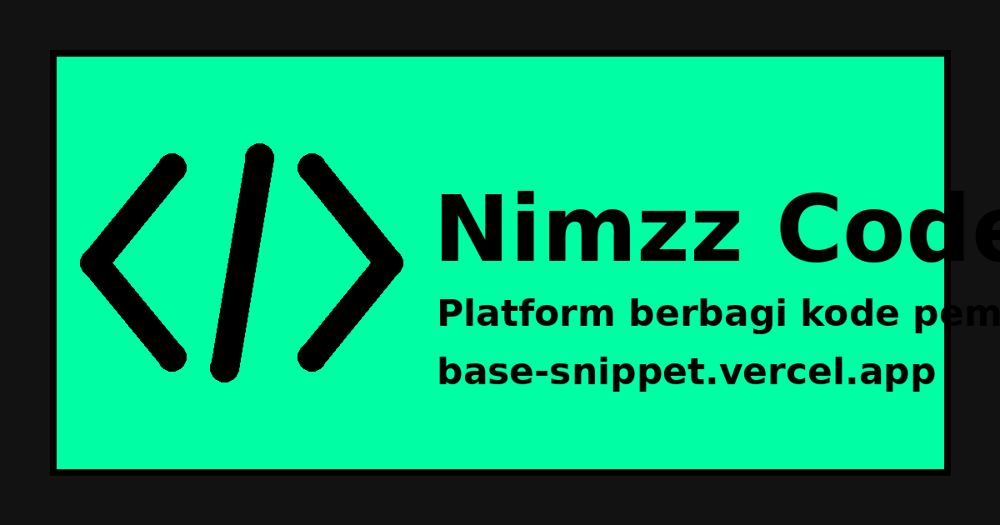

<p align="center">
  
</p>

# ⚡ Nimzz Code

Platform berbagi snippet, script otomasi, modul bot, dan project code untuk developer. Dirancang dengan palet warna hangat yang nyaman di mata (**Warm Paper & Tactile Print Edition**), responsif, mobile-first, mendukung **Mode Terang/Gelap**, serta dilengkapi fitur pencarian cepat `Ctrl+K`, Bookmark koleksi kode, dan panel admin lengkap.

- Demo: https://base-snippet.vercel.app
- Versi: 2.5.0
- Framework: Next.js 14.2 (App Router) + TypeScript

---

## 📚 Daftar Isi

1. [Fitur Utama](#-fitur-utama)
2. [Fitur Baru v2.5](#-fitur-baru-v25)
3. [Tech Stack](#️-tech-stack)
4. [Instalasi Lokal](#-instalasi-lokal)
5. [Environment Variables](#️-environment-variables)
6. [Deploy ke Vercel + Supabase](#-deploy-ke-vercel--supabase)
7. [Cara Kerja Login Admin](#-cara-kerja-login-admin)
8. [Share, Thumbnail, dan OG Image](#-share-thumbnail-dan-og-image)
9. [API Publik](#-api-publik)
10. [Upload Gambar](#-upload-gambar)
11. [Struktur Direktori](#-struktur-direktori)
12. [Catatan Perubahan](#-catatan-perubahan)
13. [Troubleshooting](#-troubleshooting)

---

## 🚀 Fitur Utama

### Snippet & Viewer
- **Viewer ala VS Code (Dark+)**: syntax highlighting, nomor baris, tab file, breadcrumb, status bar (baris/kolom, spasi, UTF-8, bahasa).
- **Aksi cepat**: Salin Kode, **Bookmark / Simpan**, **Salin Markdown**, Download File (ekstensi mengikuti bahasa), View Raw, Word Wrap, Embed, dan Share.
- **Kartu snippet** dengan washi tape cetak, thumbnail, preview kode yang terpotong halus, tombol Bookmark instan, tag, jumlah views, dan tombol Preview / Detail / Salin.
- **Quick Preview**: modal yang dirender lewat portal ke `<body>`, tampil sebagai bottom sheet di HP dan dialog di desktop.
- **Pencarian & filter** berdasarkan kata kunci, kategori, bahasa, dan tag.
- **Kategori dinamis** yang bisa ditambah atau dihapus admin.
- **Request kode**: pengunjung bisa mengirim permintaan modul, admin melihatnya di panel.

---

## ✨ Fitur Baru v2.5

1. **Command Palette (`Ctrl+K` / `⌘K`)**
   - Tekan `Ctrl+K` dari halaman mana saja atau klik tombol `Ctrl+K` di Topbar untuk mencari snippet secara instan, melompat ke halaman utama, atau membuka koleksi tersimpan dengan navigasi keyboard (`↑`/`↓`/`Enter`/`Esc`).
2. **Koleksi Bookmark Snippet (`/bookmarks`)**
   - Simpan snippet favorit ke browser sekali klik tanpa perlu login.
   - Halaman khusus `/bookmarks` dilengkapi pencarian lokal, penghitung real-time di Topbar & Sidebar, serta fitur **Export JSON** untuk mengunduh seluruh koleksi kode tersimpan sebagai cadangan.
3. **Salin sebagai Markdown (`Salin Markdown`)**
   - Di halaman detail snippet (`/code/[slug]`), tersedia tombol **Salin Markdown** untuk menyalin judul, metadata kategori/bahasa, dan blok kode berformat Markdown siap tempel ke dokumentasi atau diskusi.
4. **Palet Warna Hangat + Mode Terang & Gelap (`TERANG` / `GELAP`)**
   - Palet warna kertas hangat (`#f7f3e8`, `#2c4a3e`, `#e26334`, `#f59e0b`) yang nyaman di mata serta sakelar mode malam (`#182232`) di Topbar yang tersimpan di `localStorage`.
   - Menggunakan kombinasi 3 peran tipografi dari `next/font/google`: `Fredoka` (`--font-display`), `Zen Maru Gothic` (`--font-sans`), dan `JetBrains Mono` (`--font-mono`).

---

## 🛠️ Tech Stack

| Bagian | Teknologi |
| :--- | :--- |
| Framework | Next.js 14.2 (App Router), React, TypeScript |
| Styling | CSS Neo-Brutalism & Warm Tactile Print (`app/globals.css`) |
| Tipografi | `next/font/google` (`Fredoka`, `Zen_Maru_Gothic`, `JetBrains_Mono`) |
| Data | Supabase (REST) di produksi, file JSON di `data/` saat lokal |
| Highlight | `react-syntax-highlighter` (Prism, vscDarkPlus) |
| Keamanan | `bcryptjs`, HMAC SHA-256, rate limiter IP + Device ID |
| Upload gambar | AceImg (tanpa API key) |
| Ikon | FontAwesome 6 |
| Deploy | Vercel |

---

## 📦 Instalasi Lokal

```bash
git clone https://github.com/NimzzAI/Base-snippet.git
cd share-code-website
cp .env.example .env.local
npm install
npm run dev
```

Buka http://localhost:3000. Tanpa konfigurasi Supabase, data disimpan di folder `data/`.

Build produksi:

```bash
npm run build
npm start
```

### Di Android (Termux)
```bash
pkg install nodejs git
git clone https://github.com/NimzzAI/Base-snippet.git && cd share-code-website
cp .env.example .env.local
npm install
npm run dev
```

---

## ⚙️ Environment Variables

| Variabel | Wajib | Fungsi | Contoh |
| :--- | :---: | :--- | :--- |
| `NEXT_PUBLIC_SITE_URL` | Ya | URL situs, dipakai untuk metadata, OG image, sitemap, dan link share | `https://base-snippet.vercel.app` |
| `ADMIN_USERNAME` | Ya | Username login admin | `admin` |
| `ADMIN_PASSWORD` | Ya* | Password admin (di-hash saat server start) | `ganti-ini` |
| `ADMIN_PASSWORD_HASH` | Opsional | Hash bcrypt siap pakai, menggantikan `ADMIN_PASSWORD` | `$2a$10$...` |
| `ADMIN_SECRET` | Ya | Kunci penanda tangan cookie session. Acak dan panjang | `string-acak-panjang` |
| `INTERNAL_TEST_SECRET` | Opsional | Token untuk `/api/internal-test` | `token-rahasia` |
| `NEXT_PUBLIC_SUPABASE_URL` | Di Vercel | URL project Supabase | `https://xxxx.supabase.co` |
| `SUPABASE_SERVICE_ROLE_KEY` | Di Vercel | Service role key, hanya dipakai di server | `eyJ...` |
| `ACEIMG_API_URL` | Opsional | Ganti endpoint upload gambar | `https://api.aceimg.com/api/upload` |
| `TELEGRAM_BOT_TOKEN` | Opsional | Token bot untuk notifikasi | `123:ABC...` |
| `TELEGRAM_OWNER_CHAT_ID` | Opsional | Chat ID penerima notifikasi | `123456789` |
| `TELEGRAM_WEBHOOK_SECRET` | Opsional | Secret webhook Telegram | `string-bebas` |

\* Wajib salah satu: `ADMIN_PASSWORD` atau `ADMIN_PASSWORD_HASH`.

> ⚠️ Jangan memakai nilai default (`admin123`, secret bawaan) di produksi. Ganti `ADMIN_PASSWORD` dan `ADMIN_SECRET`.

---

## 🚢 Deploy ke Vercel + Supabase

Filesystem Vercel read-only, jadi **Supabase wajib** agar data (kode, profil owner, kategori, request) bisa disimpan.

1. Buat project di Supabase, buka **SQL Editor**, lalu jalankan isi `supabase.sql` sekali.
2. Di Vercel: **Project → Settings → Environment Variables**, isi semua variabel pada tabel di atas, terutama `NEXT_PUBLIC_SUPABASE_URL`, `SUPABASE_SERVICE_ROLE_KEY`, `ADMIN_USERNAME`, `ADMIN_PASSWORD`, `ADMIN_SECRET`, dan `NEXT_PUBLIC_SITE_URL`.
3. **Redeploy**, karena variabel baru hanya terbaca pada build berikutnya.
4. Login di `/admin/login`, lalu atur profil di **Panel → Kustom Avatar & Banner**.

Setup Telegram bot ada di [DEPLOY.md](./DEPLOY.md).

---

## 🔐 Cara Kerja Login Admin

1. `POST /api/admin/login` memverifikasi kredensial, lalu mengirim cookie `httpOnly` berisi token HMAC.
2. `GET /api/admin/session` memeriksa cookie dan mengembalikan `authenticated`.
3. `AuthProvider` (`lib/auth-context.tsx`) memanggil endpoint session saat aplikasi dibuka.

Aturan di sisi client supaya tidak ada "tiba-tiba disuruh login":

- Selama pengecekan session berjalan, `loading = true`. Halaman admin (`dashboard`, `publish`, `edit`, `settings`) hanya menampilkan skeleton dan **tidak** redirect atau menampilkan peringatan sebelum server menjawab.
- Hanya jawaban resmi server yang dapat membuat status menjadi logout. Error jaringan atau 5xx tidak mengubah status login.
- Ada penanda ringan `nimzz_admin_hint` di localStorage untuk mengurangi kedipan UI. Penanda ini hanya untuk tampilan. Hak akses tetap diputuskan server lewat cookie.

---

## 🖼️ Share, Thumbnail, dan OG Image

### Thumbnail
- Diisi di form **Publish** / **Edit** (URL gambar atau upload).
- Tampil di kartu snippet, halaman detail (di bagian paling atas), dan Quick Preview.
- Hanya alamat `http(s)://` atau path lokal yang diterima (`validThumbnail` di `lib/code-utils.ts`). Gambar yang gagal dimuat otomatis disembunyikan.

### Metadata link share
Metadata halaman detail dibuat di `app/code/[slug]/layout.tsx` (server component):
- **Judul**: `Judul Kode • Kategori`
- **Deskripsi**: `Kategori | Bahasa | deskripsi singkat`
- **Gambar utama (`og:image`)**: thumbnail snippet. Bila kosong, memakai gambar otomatis `/api/og/[slug]`.
- **Gambar cadangan**: `/og-image.png` milik situs.

---

## 🔌 API Publik

Dokumentasi interaktif tersedia di `/api-docs`.

| Method | Endpoint | Keterangan |
| :--- | :--- | :--- |
| GET | `/api/v1/snippets` | Daftar snippet. Query: `search`, `category`, `language`, `tag`, `limit` (1-50), `offset` |
| GET | `/api/v1/snippets/:slug` | Detail snippet beserta kode |
| GET | `/api/v1/snippets/:slug/raw` | Kode mentah. Tambah `download=1` untuk mengunduh |
| GET | `/api/og/:slug` | Gambar OG otomatis (PNG 1200×630) |
| GET | `/embed/:slug` | Widget iframe untuk disematkan |
| GET | `/sitemap.xml`, `/robots.txt` | Dibuat otomatis dari data |

---

## 📁 Struktur Direktori

```text
├── app/
│   ├── admin/login/            # Login administrator
│   ├── api/                    # Endpoint admin, kode, kategori, OG, Telegram, API v1
│   ├── api-docs/               # Dokumentasi API interaktif
│   ├── bookmarks/              # Halaman koleksi snippet tersimpan + Export JSON
│   ├── category/[name]/        # Daftar kode per kategori
│   ├── code/[slug]/            # Detail kode + layout metadata OG
│   ├── dashboard/              # Panel admin
│   ├── edit/[id]/              # Edit snippet
│   ├── embed/[slug]/           # Widget embed
│   ├── owner/                  # Profil developer (Polaroid ID & tautan resmi)
│   ├── profile/[username]/     # Profil publik + metadata
│   ├── publish/                # Form publish snippet
│   ├── request/                # Form request kode
│   ├── search/                 # Pencarian & filter
│   ├── settings/               # Pengaturan admin
│   ├── globals.css             # Sistem token CSS hangat & Tactile Print styling
│   ├── layout.tsx              # Root layout + konfigurasi 3 font Google
│   └── page.tsx                # Beranda
├── components/
│   ├── AppShell.tsx            # Wrapper layout
│   ├── CodeCard.tsx            # Kartu snippet + tombol Bookmark
│   ├── CodePreviewModal.tsx    # Quick Preview (portal)
│   ├── CommandPalette.tsx      # Modal pencarian cepat Ctrl+K
│   ├── CustomSelect.tsx
│   ├── FieldJournalDecor.tsx   # ParallaxHeaderBanner (60fps) & StitchedLoader
│   ├── MaintenanceGuard.tsx
│   ├── MobileTabBar.tsx        # Tab bar bawah (mobile)
│   ├── Sidebar.tsx
│   ├── ToastProvider.tsx
│   ├── Topbar.tsx              # Search, Ctrl+K, Bookmark badge, & Dark Mode toggle
│   └── VSCodeViewer.tsx        # Viewer ala VS Code
├── lib/
│   ├── auth-context.tsx        # Auth + profil di sisi client
│   ├── auth-server.ts          # Session, bcrypt, HMAC
│   ├── bookmarks.ts            # State & penyimpanan koleksi Bookmark di browser
│   ├── code-utils.ts           # Helper share, thumbnail, ekstensi file
│   ├── config.ts               # Konfigurasi terpusat
│   ├── json-db.ts, store.ts    # Akses data (Supabase / JSON lokal)
│   ├── public-api.ts           # Format respons API publik
│   ├── security.ts             # Sanitasi dan rate limit
│   ├── upload-client.ts, aceimg.ts
│   └── types.ts
├── public/                     # Ikon, og-image.png, manifest
├── data/                       # Data lokal (hanya saat tanpa Supabase)
├── supabase.sql                # Skema tabel Supabase
└── .env.example
```

---

## 📝 Catatan Perubahan

### Pembaruan v2.5.0
- **Palet Warna Hangat & Mode Terang/Gelap**: Menggunakan kombinasi warna kertas hangat (`#f7f3e8`, `#2c4a3e`, `#e26334`, `#f59e0b`) yang nyaman di mata tanpa ornamen kemah, ditambah sakelar Mode Terang/Gelap di Topbar.
- **Command Palette (`Ctrl+K`)**: Pencarian dan navigasi cepat ke seluruh snippet serta halaman menggunakan pintasan keyboard.
- **Fitur Bookmark (`/bookmarks`)**: Simpan snippet favorit tanpa login dan unduh cadangan koleksi dalam format `.json`.
- **Salin Markdown**: Ekspor cepat snippet beserta informasi bahasanya ke format blok kode Markdown.

---

## 📄 Lisensi

Dikelola oleh **Nimzz**. Dibuat untuk komunitas developer Indonesia.